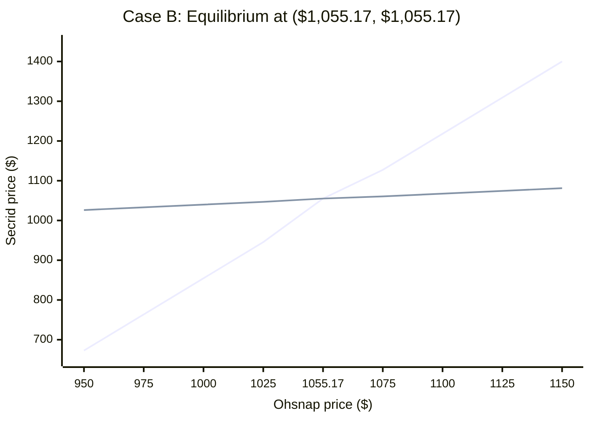

# Best Responses — Ohsnap Wallet 2 vs. Secrid Cardprotector

## 1. Three switching scenarios

I used Professor Hatch's supplied model parameters for both firms: `a = 2,600`, `b = 2`, `c = $230`, and `f = $450,000`. These are classroom assumptions, not the actual wallet costs or prices. In all three cases, `d_i + d_j = 2.2`, so only the *direction* of customer switching changes.

| Case | `d_i` (customers I gain) | `d_j` (customers I lose) | My equilibrium price | My profit |
| --- | ---: | ---: | ---: | ---: |
| A | 0.3 | 1.9 | $852.75 | $325,646 |
| B | 1.1 | 1.1 | $1,055.17 | $911,819 |
| C | 1.9 | 0.3 | $1,170.06 | $1,317,419 |

From Case A to Case C, my equilibrium price rises by about **$317.30**, and my profit rises by **$991,773**, even though total switching stays the same.

My own demand equation is `q_i = a_i - b_i p_i + d_i p_j`. It shows how my demand changes when Secrid raises its price, but it does not show how many of my customers Secrid gains when *I* raise mine. For that, I need Secrid's equation and `d_j`. The cases show why the direction of switching matters, not just its total amount.

I checked Cases A, B, and C against Table 12.1 in Professor Hatch's *How Differentiation Preserves Margin*. My rounded prices and profits match the published results: https://ea.nilehatch.com/differentiated-competition.html

## 2. Best-response lines — Case B

The best-response formulas are:

- **Ohsnap:** `p_i = (a_i + b_i c_i + d_i p_j) / (2 b_i)`
- **Secrid:** `p_j = (a_j + b_j c_j + d_j p_i) / (2 b_j)`

With `d_i = d_j = 1.1`, both become:

- **Ohsnap:** `p_i = 765 + 0.275 p_j`
- **Secrid:** `p_j = 765 + 0.275 p_i`

The graph below puts **Ohsnap's price (`p_i`) on the horizontal axis** and **Secrid's price (`p_j`) on the vertical axis**. To plot Ohsnap's line on these axes, I rearranged it as `p_j = (p_i - 765) / 0.275`. Secrid's line is `p_j = 765 + 0.275 p_i`.

**Line key:** The **steeper line** is Ohsnap's best response (rearranged for these axes). The **flatter line** is Secrid's best response. The **equilibrium is labeled in the chart title and at the $1,055.17 x-axis tick**, where both plotted lines meet: **`(p_i, p_j) = ($1,055.17, $1,055.17)`**. This is the equilibrium: neither firm can increase its profit by changing its price alone. It is not an agreement or collusion.

## 3. Follow rate

My follow rate in Case B is `d_i / (2 b_i) = 1.1 / 4 = 0.275`. If Secrid raises its price by $1, my best-response price rises by **27.5 cents**. I follow only partway because raising my own price also causes some customers to buy less or leave, so matching the full increase would not maximize my profit.

## 4. What if `d_i = 0`?

If `d_i = 0`, my best-response equation becomes `p_i = 765`. Secrid's price drops out completely because an increase in Secrid's price does not send any extra customers to me. This shows one benefit of differentiation: when customers do not see the products as close substitutes, my best price is less dependent on my rival's price.
